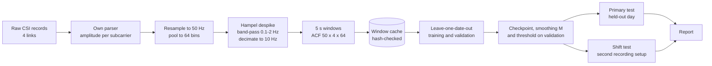
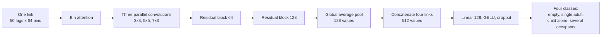

# wifi-csi-hpe: child presence detection from in-car Wi-Fi CSI

Supervised detection of a child left alone in a parked car from Wi-Fi channel state information (CSI). The models are trained from scratch and evaluated on recording days that were never used for training, with the alarm threshold fixed on validation data only.

In the dataset used here, the child is always a **dummy infant with simulated weak breathing**. Results describe the detection of this dummy, not of real children.

## What the project does

- Reads raw CSI records from a MediaTek MT7925 radio (2 transmit × 2 receive antennas, four links) with its own parser, checked against the vendor parser.
- Cuts each labelled session into 5 s windows and turns each window into an autocorrelation (ACF) tensor of 50 lags × 4 links × 64 frequency bins.
- Compares four candidates under one protocol:
  - **B0**, a detector that never alarms (floor);
  - **B1**, a logistic regression on bin means and spreads of the ACF (1,604 weights);
  - **C1**, a convolutional network with one encoder shared by the four links (367,444 parameters, selected on validation);
  - **C2**, a small transformer over lag tokens (91,140 parameters).
- Chooses the checkpoint, the smoothing length and the alarm threshold on validation data only. The threshold is the lowest one that gives no validation false alarm.
- Reports recall, false-alarm rate, AUROC, partial AUC, per-session results, time to alarm and bootstrap intervals over segments.

## Architecture flow



C1, the selected model, reads each link with the same encoder:



The child score is the softmax probability of "child alone". Details are in [`docs/ARCHITECTURE.md`](docs/ARCHITECTURE.md) and [`docs/PIPELINE.md`](docs/PIPELINE.md).

## Data

The dataset is **not included** in this repository and is not public; access is through its owner. It holds in-car CSI with synchronised cabin video in two collections:

| Collection | Band, channel | Days | Sessions used | Role |
|---|---|---|---|---|
| A | 6 GHz, 160 MHz | 2026-08-25, 08-26, 09-01 | 11 | training and validation (leave one date out) |
| A | 6 GHz, 160 MHz | 2026-08-28 | 2 | primary test |
| B | 5 GHz, 80 MHz | 2026-09-11, 09-17 | 8 | shift test |

The video is used only to check labels and is never a model input. Labels are `empty`, `single-adult`, `single-child` (the dummy infant alone, the positive class) and `multiple`; `transition` and segments whose child type is `unknown` are excluded. See [`docs/DATASET.md`](docs/DATASET.md) for the session list and [`docs/DATA_CONTRACT.md`](docs/DATA_CONTRACT.md) for the observed schema, checks and hazards.

`config.py` expects the raw data at `../MTK_dataset` relative to this folder.

## Setup

```bash
conda create -n wifi-csi python=3.11
conda activate wifi-csi
pip install -r requirements.txt     # pick the torch build that matches your CUDA
export OMP_NUM_THREADS=2
python -m pytest -q                 # unit tests
```

## Usage

```bash
python main.py check                                   # Python, NumPy, PyTorch, visible GPUs, free memory
python main.py preprocess --workers 8                  # build cache/<id>/ from the raw data (never overwrites)
python main.py train --candidate c1 --val-date 2026-08-25 --seed 0 \
                     --run smoke --device cuda:0 --epochs 3   # one model; candidates b0 b1 c1 c2
python main.py study --run study --gpus cuda:0 cuda:1 --per-gpu 3   # every candidate, validation date and seed
python main.py report --runs study --name study        # tables, ROC figure and REPORT.md under results/
```

- Every run writes `runs/<run>/<candidate>/val_<date>/seed_<s>/` with its configuration, versions, device, seed, cache id and split hash, and refuses to reuse an existing directory. Failed runs are kept, not overwritten.
- `--device` is always explicit (`cpu` or `cuda:N`). `study` checks free GPU memory before launching jobs.
- Extra options: `--design` selects the split design (`lodo` is the main study; the others are the post hoc analyses below), `--candidates` restricts a study, and `--epochs`, `--patience`, `--encoder-lr`, `--head-lr` override training settings for experiments.
- `analysis/collection_shift.py` measures how separable the two collections are; `analysis/thesis_cd_summary.py` summarises the training-on-both-collections and leave-one-session-out runs.

## Results

Mean over runs at the validation-chosen operating point (three runs for B1, nine for C1 and C2):

| Split | Model | Recall | False-alarm rate | AUROC |
|---|---|---|---|---|
| Primary test (held-out day, Collection A) | B1 | 0.876 | 0.016 | 0.977 |
| | C1 | 0.915 | 0.008 | 0.989 |
| | C2 | 0.197 | 0.001 | 0.907 |
| Shift test (Collection B) | B1 | 0.147 | 0.002 | 0.770 |
| | C1 | 0.086 | 0.098 | 0.617 |
| | C2 | 0.000 | 0.029 | 0.392 |

- Within one recording setup, C1 detected the dummy infant alone on an unseen day with under 1% false alarms and raised an alarm within 30 s in every child-alone segment.
- The logistic regression came close to the CNN at a small fraction of its size.
- Detection did not transfer to the second setup. Adding one day of that setup to training recovered much of the loss (post hoc).
- The primary test has two child-alone segments, so these numbers carry wide uncertainty. See [`docs/EVALUATION.md`](docs/EVALUATION.md) for the protocol and its limits.

## Repository layout

```
main.py            command-line entry point (check, preprocess, train, study, report)
config.py          every setting in one place
src/               CSI reader, window index, features, cache, splits, baselines, models, training, metrics, report
tests/             unit tests (parser, index, cache, features, splits and leakage, training, metrics, report)
analysis/          post hoc analyses
docs/              architecture, pipeline, evaluation, data contract, dataset description
```

## Author

Trong Phuc Nguyen (Axel), University of Technology Sydney, Bachelor of Computer Science (Honours), 31482 Honours Project.
