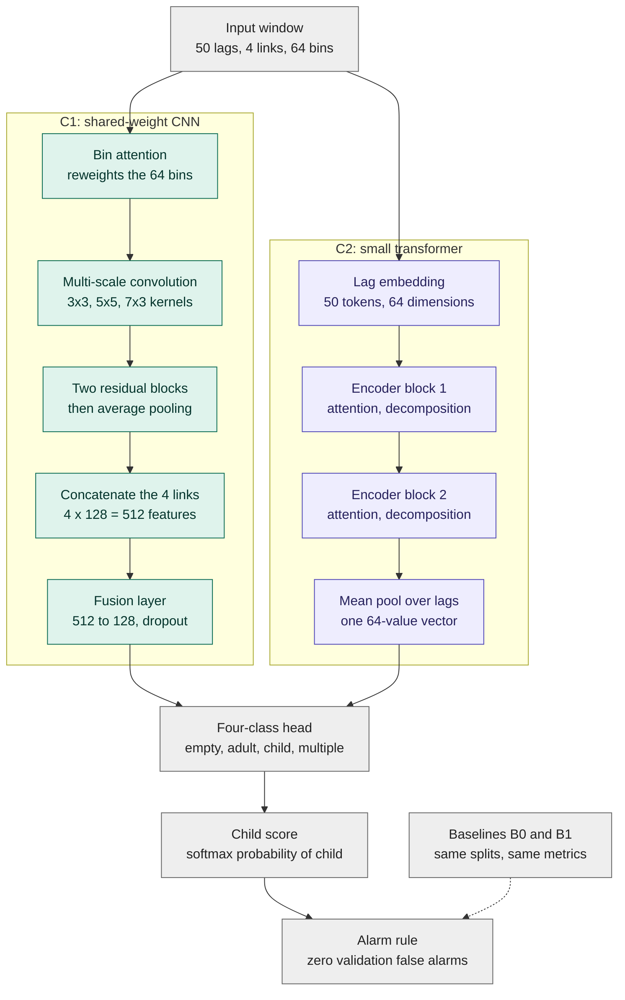

# Architecture

The input, the baselines, the two learned candidates and the training objective. The code in `src/model.py` and `src/baselines.py` is the reference.

## What the data allows

| Fact | Consequence |
|---|---|
| 19 positive segments overall (11 in the training pool, about 1,640 s of child time) | The model must stay small. The signal is one long segment per session, so more windows do not add independent evidence. |
| Four T x R links, 512 subcarriers in A and 256 in B, 47 to 87 Hz | Resample each link to a fixed rate. Pool subcarriers to a fixed number of bins. |
| The child is a dummy with weak breathing; the adult moves | Periodicity and small motion carry the signal. ACF features expose both. |
| Hard negatives: `multiple` includes an adult plus the dummy; `single-adult` is scarce | Train four classes, not two. Report false alarms per negative type. |
| False alarms dominate the success criterion | A calibrated score, a validation-chosen threshold, and optional temporal smoothing. |
| GPUs: two idle L4 cards, 23 GB each; budget up to 5 to 6 hours | Models of a few hundred thousand parameters train in minutes. The budget allows several seeds and candidates. |

## Diagram

B0 never alarms. B1 is a logistic regression on the bin-mean and bin-spread of the cached ACF. C1 and C2 are the two learned candidates.

## Input contract

`X`: `float32`, shape `(B, 50, 4, 64)`. Axes: 50 autocorrelation lags at 10 Hz (5 s), four links in the fixed order `T0R0, T0R1, T1R0, T1R1`, 64 frequency bins.

Label `y`: integer in `{0: empty, 1: single-adult, 2: single-child, 3: multiple}`. The child-alone score is the softmax probability of class 2.

Each window carries `session`, `segment`, `collection`, `date` and epoch bounds in the cache index. These identifiers travel with every prediction.

The ACF divides each lag by the window variance, so no normalisation statistic is fitted. Nothing in the input pipeline is fitted on training data, apart from the baseline model's feature scaler.

## Candidates

Two learned candidates and two baselines. Every candidate reads the same cache, uses the same loss and receives the same selection rule. I recommend implementing C1 first, then C2, and picking the winner on validation data only.

### Baselines (B0, B1)

- **B0, never alarm.** Zero false alarms, zero recall. It marks the floor and confirms the reporting code.
- **B1, feature logistic regression.** Mean and standard deviation over the 64 bins of the cached ACF for every (lag, link), 400 numbers per window, standardised on training windows, class-weighted, L2 penalty C = 0.1. Fitted with scikit-learn. (Band-power features were considered first, but they need the raw signal and the cache holds only the ACF.) It tests whether the network adds anything over a transparent statistic.

### C1: multi-link CNN with a shared encoder (selected)

Adapted from an earlier in-house CSI classifier to this input:

1. Frequency-bin attention: a small MLP computes weights over the 64 bins from the lag-averaged input and rescales the input.
2. Multi-scale convolution: three parallel convolutions (3x3, 5x5, 7x3), 16 channels each, batch norm, GELU.
3. Two residual blocks with stride 2 (64 and 128 channels), then global average pooling. This gives 128 features per link.
4. **One encoder shared by all four links.** Concatenate the four vectors (512 features), then Linear(512, 128), GELU, dropout 0.2, Linear(128, 4).

Parameter scale: about 301,000 for the encoder plus about 66,000 for fusion and 500 for the head, 367,444 in total (checked by a test).

Why shared: 19 positive segments cannot support four separate encoders. Sharing also lets link permutation act as a valid augmentation.

### C2: simplified DeepCPD-style transformer

DeepCPD (Jayaweera et al., 2025, [arXiv:2505.08931](https://www.alphaxiv.org/abs/2505.08931)) detects child-only presence in cars. It computes the ACF per subcarrier, stacks the ACFs of all links into one matrix (lags by subcarriers), and classifies empty, child and adult with an Autoformer-style encoder and an MLP head. Its ablations favour subcarrier-wise ACF over averaged ACF, a series-decomposition block (+8% accuracy in its data), and link permutation and link mix augmentation. It reports 92.86% accuracy, a 91.45% child detection rate and a 6.14% false-alarm rate on unseen cars, with a two-stage pre-training I cannot reproduce here and with real babies alongside a doll. Those numbers do not transfer to this dataset.

Simplified here:

1. Reshape `(50, 4, 64)` to a matrix of 50 lags by 256 columns (links x bins). Each lag is one token.
2. Linear embedding of each token to 64 dimensions, plus a learned positional embedding over the 50 lags.
3. Two encoder blocks: standard multi-head attention (4 heads) over the lags, a moving-average series decomposition along the lags that keeps the seasonal part, and a feed-forward network.
4. Mean pool, then the same four-class head as C1.

Left out: the FFT-based auto-correlation attention, the two-stage pre-training and link mix. Any of them can return if C2 shows promise on validation. Size: 91,140 parameters.

### Decision rule

Pick between C1 and C2 on validation data only. C2 replaces C1 when its mean per-date validation partial AUC exceeds C1's by more than the seed spread: the standard deviation across seeds within a date, averaged over the three dates and both candidates. Otherwise keep C1. The choice appears in the report before any test number. In the study, C1 was kept.

## Objective and heads

- One head, four logits, class-weighted cross-entropy. Weights are the inverse class frequencies of the training windows, normalised to mean 1.
- Class imbalance: this weighting only. No oversampling, no focal loss, no Mixup. Add one only if validation shows collapse onto the majority class.
- No auxiliary heads, no adversarial branch, no count head.

## Optimisation

AdamW, learning rate 3e-4 for the encoder and 1e-3 for the head, weight decay 1e-2, cosine schedule to 1e-6, gradient clipping 1.0, batch 128, at most 40 epochs, early stopping after 8 epochs without a validation gain. These values come from an earlier in-house model and were the starting point. The smoke run checks that they train; they are not tuned on any test data.

## Post-processing (optional, chosen on validation)

DeepCPD and RapidPD both smooth decisions over time. This project evaluates a moving average of the child score over the last `M` non-overlapping windows, `M` in `{1, 3, 5}`. `M` and the threshold are picked together on validation. The report shows `M = 1` as well. A larger `M` adds latency: 15 s for `M = 3` with 5 s windows.

## Alternatives rejected

| Alternative | Reason |
|---|---|
| Raw CSI into a CNN | DeepCPD reports poor transfer to unseen setups. The dataset is too small to learn invariance. |
| Complex CSI / phase ratio features | Adds a second signal path. Deferred until the amplitude ACF result is known. |
| Separate encoder per link | 4x the parameters for 19 positive segments. |
| Binary head only | Discards the labeled hard negatives. |
| Domain-adversarial or SSL training | Out of scope: models are trained from scratch with ordinary supervised learning. |
| Autoformer FFT attention | Extra code before a plain transformer has been tried. |
