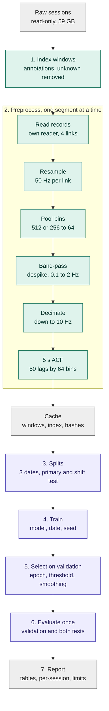

# Pipeline

From raw CSI to the report. `README.md` lists the commands; where this file differs from the code, the code wins.

## Flow



Grey: data and outputs. Green: data preparation. Purple: modelling.

## Step details

### 1. Index

Reads every `annotations_v2.json`. Keeps a 5 s window only if all of its 5 s lie inside one segment whose label is one of the four classes, that is not `transition`, and whose `child_type` is not `unknown`. Windows start every 1 s inside a segment. A window flagged `eval_nonoverlap` starts at a multiple of 5 s from the segment start, and only these enter reported metrics. Output: `index.csv`.

### 2. Preprocess

For each session, read only the records inside eligible windows (plus a 5 s margin on each side for the filter) by seeking to `offset` in `timestamps.csv`. This avoids scanning 59 GB.

1. Parse each record with the project's own reader (`numpy.frombuffer` on the I and Q tags), take the amplitude, and skip records whose subcarrier count differs from the collection's dominant width (512 for A, 256 for B).
2. For each of the four links, interpolate onto a 50 Hz grid over the span of the segment.
3. Average contiguous subcarriers into 64 bins (groups of 8 in A, 4 in B).
4. Hampel despike, then a fourth-order Butterworth band-pass (0.1 to 2.0 Hz, zero-phase), then decimate to 10 Hz.
5. Cut 5 s windows and compute the ACF per (link, bin) with the lag-dependent divisor.
6. Reject a window when any link has a gap longer than 0.5 s inside it. The number rejected is reported.

Processing runs per segment, but each segment is read with 5 s of extra signal on both sides (`margin_s`) for the interpolation, despiking and filtering. The 0.1 Hz high-pass filter has a memory of about 20 s, so a window near a segment edge partly reflects the neighbouring segment (transition, unknown-child or another class). Measured on five segments: features change by about 26% at the edge, 10% at 10 s and 1% at 20 s when the margin grows from 5 s to 40 s. Filtering each segment on its own signal is worse (76% at the edge, 23% at 10 s, 3% at 20 s, start-up artifacts). The cache therefore keeps the context and records each window's distance to its segment edge (`edge_distance_s`); the report adds a table for windows at least 20 s from an edge. Output shape `(N, 50, 4, 64)`, `float32`. 13,706 windows at 1 s stride, 0.7 GB.

The cache id is a hash of the preprocessing parameters, the code files for steps 1 to 6, and the per-session source metadata hashes. `manifest.json` stores the array hash. Training refuses a cache whose id or array hash does not match.

### 3. Splits

One function builds the splits from the index (rules in `EVALUATION.md`) in memory (`src/splits.py`); the split hash is recorded in every `run.json`. Unit tests assert that no session and no segment appears in two places.

### 4. Train

One run trains one candidate on two of the three pool dates and validates on the third, with one seed. Per epoch: validate, append a line to `epoch_metrics.jsonl`, save `best.pt` when the validation criterion improves. After training, load `best.pt`, pick the threshold and `M` on validation scores, then score validation, primary test and shift test once.

### 5. Report

A script reads finished run directories and writes CSV, JSON and one Markdown report. It never edits run directories.

## Artifacts

```
wifi-csi-hpe/
  cache/<cache_id>/          windows.npy, index.csv, manifest.json
  runs/<run_id>/
    <candidate>/val_<date>/seed_<s>/
      status.json            running | complete | failed (+ error text)
      run.json               device, GPU name, torch/numpy versions, seed, full config,
                             command line, cache id, split hash, source-file hashes
      epoch_metrics.jsonl    neural candidates only
      best.pt, final.pt      neural candidates only
      predictions.csv        one row per window; `split` column = val | primary | shift;
                             window id, session, segment, label, four probabilities
      metrics.json           operating point (M, threshold) and metrics per split
  results/<run_id>/          fold tables, pooled tables, figures, REPORT.md
```

## Failure and restart

- A run directory is created once. If it exists the command refuses. A new attempt uses a new `run_id`.
- `status.json` starts as `running` and becomes `complete` only after the metric files exist. A killed job stays `running` and is listed as failed by the report, never deleted.
- A study command skips a `complete` run directory and refuses a `running` or `failed` one. There is no mid-epoch resume, because a run lasts minutes.
- Failed runs stay on disk and appear in the report.

## GPU and runtime protocol

Before every training batch of jobs:

1. Run `nvidia-smi`. Check processes, utilisation and free memory on both cards. Do not use a card another job holds.
2. Read `CUDA_VISIBLE_DEVICES` (empty on 2026-09-30, which exposes both cards). If it exposes one card, address it as `cuda:0` and record the physical index.
3. Pass `--device cuda:N` explicitly. `auto` is allowed only in smoke tests.
4. In Python, confirm `torch.cuda.is_available()`, the device name, and a small allocation before loading data.
5. Measure peak memory with one training batch and print it. One C1 job needs 2.5 to 2.7 GB alone and peaked at 5.5 GB while nine jobs shared a card (one ran out of memory in `study1`). `main.py study` therefore checks free memory before launching and refuses a `--per-gpu` value whose jobs (5.5 GB each) do not fit; the default is 3 per card. CPU and RAM (188 GB, 32 cores) stay well within limits at 2 threads per job.
6. Write device, GPU name, versions, seed, configuration, cache id, split hash and command into `run.json`.

Observed on 2026-09-30: two NVIDIA L4 (23 GB each), driver 570.144, CUDA 12.8 driver, torch 2.7.1+cu126, both cards idle apart from Xorg. These are runtime facts to re-check, not constants.

## Commands (also in `README.md`)

```bash
python main.py check
python main.py preprocess --workers 8
python main.py train --candidate c1 --val-date 2026-08-25 --seed 0 --run smoke --device cuda:0 --epochs 3 --cache <cache id>
python main.py study --run study4 --gpus cuda:0 cuda:1 --per-gpu 3 --cache <cache id>
python main.py report --runs study4 --name study4
python -m pytest -q
```
